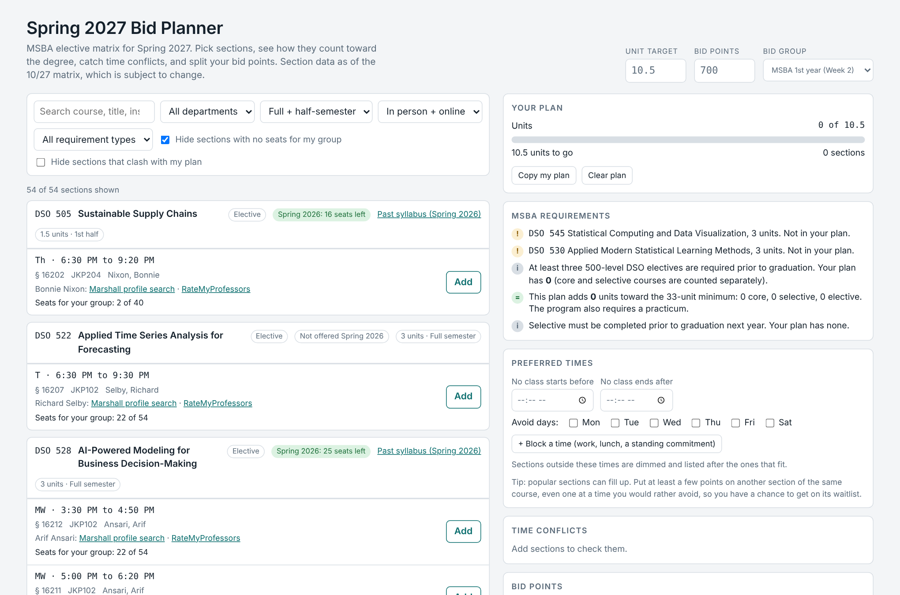
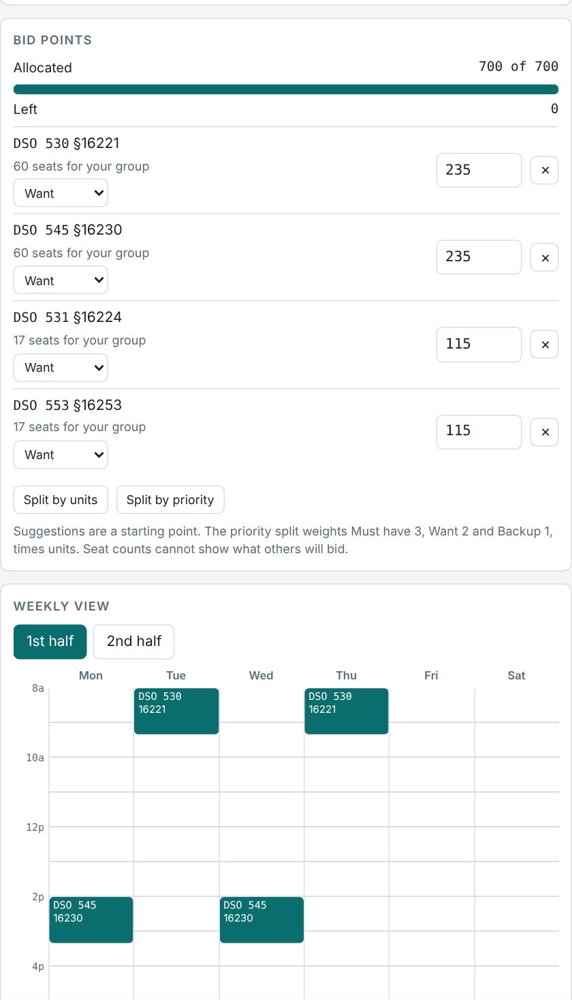
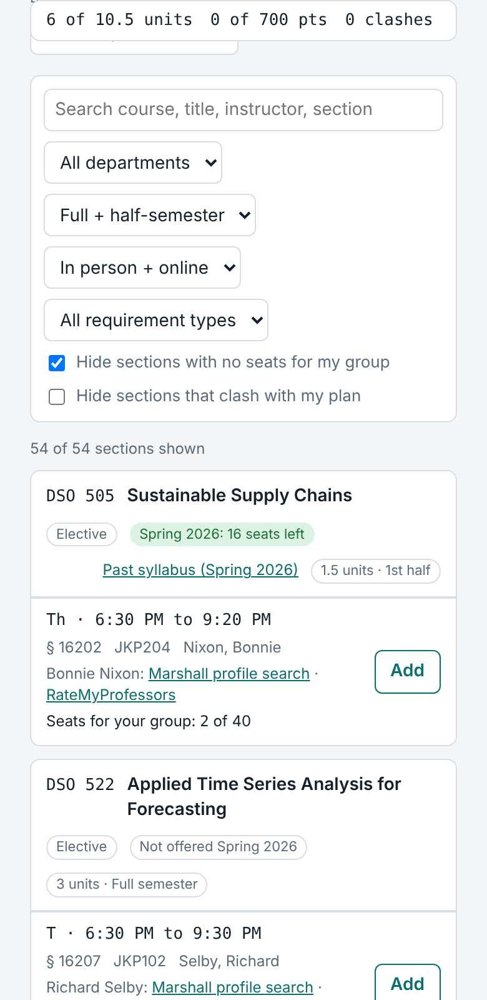

# MSBA Class Bidding Planner

**Pick your Spring 2027 electives, split your 700 bid points, and catch time conflicts before bidding opens.**

[**Live planner**](https://navyagup014.github.io/MSBA-Class-Bidding-Planner-/) · [How to use](#how-to-use) · [Unofficial, built by a student](#caveats)



---

## The problem

USC Marshall MSBA students bid 700 points on about 10.5 units of electives each spring. The decision is spread across a section matrix, the degree requirements, last year's seat counts and each student's own schedule. It is easy to bid on two classes that clash, miss a core course, or put every point on one section that fills up.

## What it does

| | |
|---|---|
| **Browse** | All 54 sections on the Spring 2027 graduate elective matrix. Search, or filter by department, term, format, and core / selective / elective. |
| **Fit the degree** | A live requirements panel shows core, selective and elective units in your plan against the 33-unit minimum. |
| **Catch conflicts** | Overlaps are flagged, with half-semester awareness (1st half and 2nd half classes don't clash). |
| **Preferred times** | Type the earliest start, latest end, days or windows to avoid. Sections that don't fit are dimmed and moved to the bottom, not hidden. |
| **Last year's seats** | Spring 2026 seats left, by course and by professor where a course has several. A signal of how fast a class filled. |
| **Split your points** | Tag each course Must have, Want or Backup, then split 700 points by units or by priority and adjust by hand. |
| **Copy my plan** | One tap copies your sections, points and warnings to paste into your notes. |

<p>
  
  
</p>

## How to use

1. Open the live planner (or `index.html`) in any browser.
2. Pick your bid group, then add preferred times.
3. Add sections to your plan. Core courses show in teal on the weekly calendar, everything else in a lighter colour.
4. Tag priorities, split your points, and aim for 10.5 units and 700 of 700 points.
5. Tap **Copy my plan**, then place your bids on Web Registration.

## How it was built

1. **The data** — transcribed from photos of the 10/27 Spring 2027 elective matrix, plus Spring 2026 seat data from the public USC class archive.
2. **The rules** — core, selective and elective categories follow the program's published requirements.
3. **The build** — a single self-contained `index.html` (plain HTML, CSS and JavaScript, no framework or server), built with **Claude Code**. The conflict, seat and points logic was tested with scripted checks in a headless browser.
4. **Voice of the customer** — feedback from program staff shaped the final version: removed tight/roomy labels, added by-professor seat data, preferred times, and core vs elective calendar colours.

## Technical highlights

- **Single file, no backend.** Nothing is sent anywhere. Your plan is saved only in your own browser.
- **Half-semester conflict logic.** Full-semester classes overlap everything; 1st-half and 2nd-half classes only overlap their own half.
- **Preferred-time sorting.** Fitting sections come first; a course with no fitting section stays visible with a note.
- **Priority split.** Points are weighted Must have 3 : Want 2 : Backup 1 times units, rounded to 5, with the remainder added to the largest bid.
- **Phone-friendly.** A sticky summary bar keeps units and points in view on small screens.

**Stack:** HTML · CSS · vanilla JavaScript · GitHub Pages

## Run it yourself

```bash
git clone https://github.com/navyagup014/MSBA-Class-Bidding-Planner-.git
cd MSBA-Class-Bidding-Planner-
open index.html        # or double-click it
```

No install step. To host it, turn on GitHub Pages (Settings → Pages → `main` / root).

## Caveats

- This is an **unofficial** student tool, not affiliated with USC. Always confirm sections and place bids on Web Registration.
- Section data is as of the 10/27 matrix and may change.
- Seat counts show how classes filled last year. They are **not** demand and **not** winning bid prices.
- The Professor and syllabus links are search shortcuts and may not land on the exact page.
- DSO 599 section 16334 has a seat mismatch in the original printout, kept as printed.

## Author

Navya Gupta — [@navyagup014](https://github.com/navyagup014), USC Marshall MS in Business Analytics
